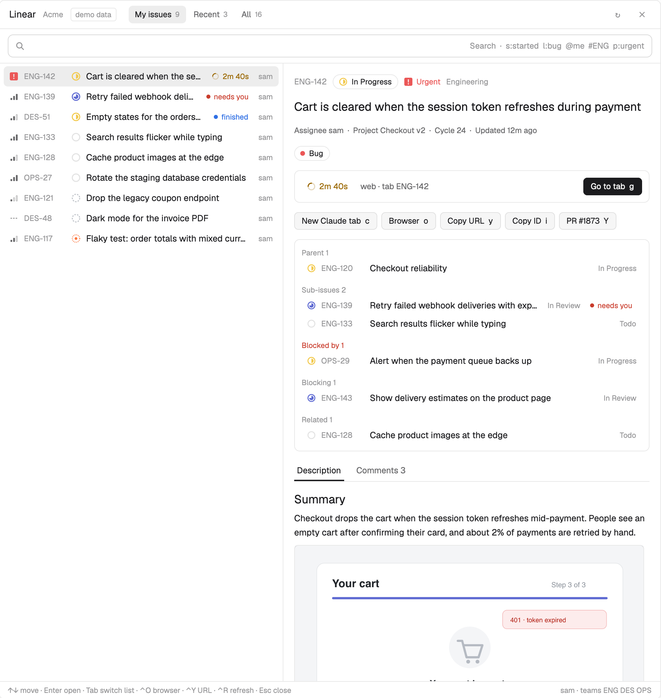
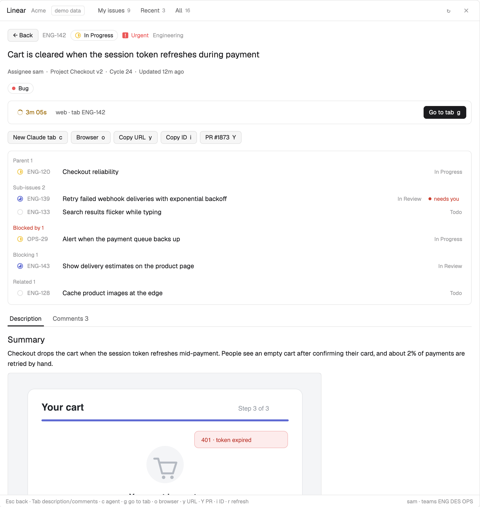
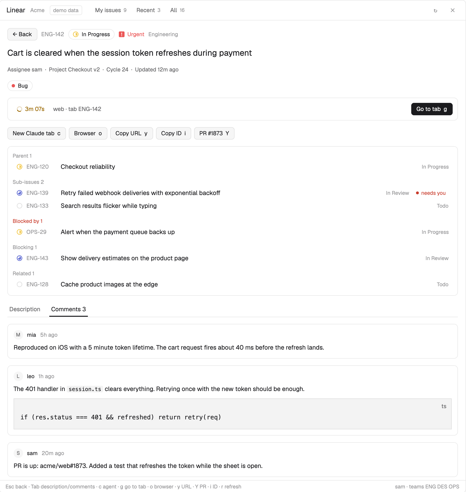

# Linear for Herdr

**Find, read and start work on Linear issues without leaving the [Herdr app](https://herdr.dev).** A window with your open issues, instant search, a live preview with images and comments, and one key to hand an issue to a coding agent in a new tab. The list then shows how long that agent has been working.

A native port of [herdr-linear](https://github.com/jenthous/herdr-linear), the terminal plugin for herdr, to a Herdr app mod.



## Features

- **Three lists.** My open issues, recently opened, and all issues of every team your API key belongs to (no team setup).
- **Search as you type.** Loaded issues filter at once; after a 0.3 s pause the server is asked too. Mix free text with tokens: `s:started`, `l:bug`, `@me`, `#ENG`, `p:urgent`, or an identifier like `ENG-142`. The last row searches comments as well.
- **Linear's look.** State icons (backlog, todo, in progress, in review, done, canceled) in each state's color, and priority bars with the urgent mark.
- **Preview and detail.** Description with images, comments, the open pull request, and parent, sub-issues, blocked by, blocking and related issues. Click a relation to follow it; Esc comes back.
- **Images.** Images in descriptions and comments are downloaded once (Linear uploads with your key) and fitted to the window. Click one to open it full size.
- **Agents.** `c` opens a new tab named after the issue running your agent (Claude Code by default) with the issue as its first message. Any tab whose name contains an identifier is linked: the issue shows a spinner and the elapsed time while the agent works, "needs you" when it's blocked, and `g` takes you there.
- **Current branch.** The issue of the focused pane's branch (`me/eng-142-…`) is pinned on top of My issues.
- **Fast reopen.** Everything fetched is cached, so the window shows your lists instantly and refreshes in the background every 60 s.



## Install

1. Copy `mods/linear` into `~/.config/herdr-app/mods/`.
2. Merge `keys.json` into `~/.config/herdr-app/keys.json` (it binds `cmd-i` to open the window; pick another key if you use that one).
3. Run `herdr-app check ~/.config/herdr-app/mods/linear`, then press `cmd-i`.

Or ask the agent in your Herdr terminal: *"add herdr.dev/mods/jenthous/herdr-app-linear"*.

### API key

Create a personal API key in Linear → Settings → Security & access → Personal API keys. The mod looks for it in this order:

1. `LINEAR_API_KEY` in your login environment
2. `~/.config/herdr/plugins/config/jh.linear/credentials` (herdr-linear's)
3. `~/.config/herdr-linear/credentials`

If none is found, the window asks for it and saves it to the last path with mode 0600. The key is only sent to `api.linear.app` and `uploads.linear.app`, in the `Authorization` header.

## Keys

| Where | Keys |
|---|---|
| List | type to search, ↑/↓ or ⌃N/⌃P move, Enter open, Tab/⇧Tab switch list, ⌃O browser, ⌃Y copy URL, ⌃R refresh, Esc clear search or close |
| Detail | Esc back, Tab description/comments, `c` agent tab, `g` go to the agent's tab, `o` browser, `y` copy URL, `Y` copy PR link, `i` copy ID, `r` refresh, `q` close |

Commands for `keys.json` or `herdr-app do`: `linear.search`, `linear.refresh`, `linear.open:ENG-123`, `linear.comments` (switch description/comments), `linear.demo` (toggles demo data, no key needed).

## Settings

Optional `mods/linear/config.json` (see `config.example.json`):

```json
{
  "language": "en",
  "agent": ["claude"],
  "agentName": "Claude",
  "refreshSeconds": 60
}
```

- `language`: `en` (default) or `ko`.
- `agent`: the command `c` starts in the new tab, e.g. `["codex"]`.



## What it touches

- **Network:** `api.linear.app` (GraphQL) and the image hosts linked in issues.
- **Programs:** `curl`, `file` and `sips` (image size, macOS) for images, `open` to show an image full size, `sh` for file permissions.
- **Files:** reads the credential files above; writes its cache to `mods/linear/.cache/` (mode 0700).

## License

MIT
