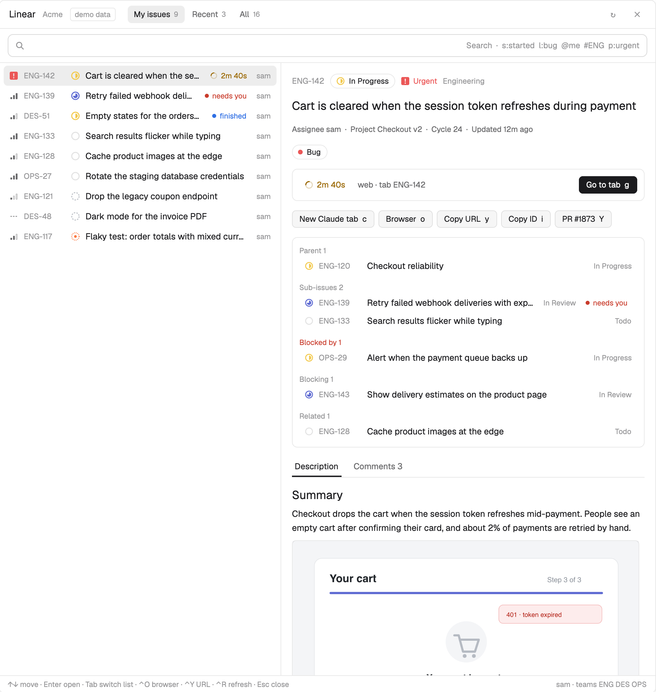

# Linear

A floating window for Linear inside the Herdr app: your open issues on the left, the selected issue on the right with its description, images, comments and relations, and one key that starts a coding agent on the issue in a new tab. Tabs named after an issue show their agent's status and elapsed time next to that issue.

## What you see

- **Window:** a Herdr `window` overlay, 980 px wide and 80% of the window tall, theme `popover` background, opened with `cmd-i`. It remembers where it was dropped and reopens on the next start.
- **Header (42 px):** "Linear" 14 px semibold, the organization name 11.5 px `dim`, then three list tabs (My issues · Recent · All) as 26 px pills with counts; selected is `selected` background. On the right a spinner while loading, refresh `↻` and close. In demo mode a small bordered "demo data" tag follows the organization.
- **Search bar:** a 34 px rounded field with a search icon; the token hint (`s:started l:bug @me #ENG p:urgent`) shows at its right end while empty.
- **List (420 px when the window is at least 760 px wide, else full width):** 30 px rows: priority icon (14 px: three bars filled by level, `muted`; urgent is a red `#eb5757` rounded square with `!`; none is three dashes), identifier 11.5 px `dim`, state icon in the state's Linear color (dashed circle backlog, empty circle todo, half-filled in progress, three-quarter in review, check done, cross canceled), title, then a PR badge if a pull request is linked, then an agent badge if a tab is linked, then the assignee. The selected row is `selected`.
- **Preview / detail:** back button (detail only), identifier (click copies), a state chip with icon, the priority icon and name, team. The title as a markdown heading. A meta line (assignee, project, cycle, due, updated). Label chips. When a tab is linked: a `surface` box with the big agent badge, "space · tab name" and a primary "Go to tab" button. Action buttons: "Work with Claude" (primary when no tab is linked), Browser, Copy URL, Copy ID, and a bordered PR badge ("repo #n", review and conflict marks, then the state, review and "conflicts" in words, and `Y`) when one is linked. A `surface` box of relations (Parent, Sub-issues, Blocked by in `blocked` color, Blocking, Related), each row with a state icon. Label chips end with a dashed-looking "+ Label" pill. Then a "Description" divider, the description, the issue's reaction pills and "☺ +", a "Comments n" divider and the comment threads: `surface` cards (initial avatar circle, name, time, then "☺ +", "Reply", and "Edit" on your own; markdown body; reaction pills), replies inside the card behind a 2 px `border` line. On the right (pane at least 640 px, and there are headings or comments) a 200 px outline: "Description", its h1–h3 headings indented by level, "Comments n", then one row per thread (16 px avatar, name, ↳replies, M/D). Under the page, pinned, the comment box.
- **Footer (26 px):** key hints, or a flash after copying (`done` color) or an error (`blocked` color); on the right the viewer's name and team keys.

## How it behaves

- **PR badge:** from the issue's `attachments` whose URL has `/pull/` or `/merge_requests/`, the most relevant one: open, then draft, then merged, then closed, newest first within each. A PR icon (merged and closed have their own) and `#number` in GitHub's colors: open `#3fb950`, draft `dim`, merged `#a371f7`, closed `#f85149`. For open and draft PRs, each reviewer's latest decision from `metadata.reviews` (dismissed clears it) gives ± in `#d29922` when anyone requested changes, else ✓ in `#3fb950` when anyone approved; `metadata.hasConflicts` adds ⚠ in `blocked`. Clicking it opens the PR; `Y` copies its URL.
- **Terminal issues (`terminalIssues`):** when the window opens, `hc read <focused terminal> --lines 300`; identifiers come from `linear.app/<org>/issue/<ID>` links and from bare `KEY-123` whose key is one of the viewer's teams (not after a letter, digit, `.` or `-`, so branch names count and `UTF-8` doesn't), last mentioned first, at most 9. Ones not cached are fetched in one `issues` query (`or` of `{team.key, number in}`); unknown ones are dropped. With an empty search, a "In the terminal n" heading and those rows go on top of every list (selected first), then a heading with the list's name; they're left out of the list below and the current-branch pin.
- **Agent badge:** working = spinner (`working` color) plus elapsed time ("2m 34s", ticking each second only while some linked agent works); blocked = dot plus "needs you" (`blocked`); done = dot plus "finished" (`done`); idle = terminal icon plus "tab". Clicking it selects that space and tab.
- **Linking:** any tab whose name contains `[A-Za-z][A-Za-z0-9]*-\d+` links to that issue; when several do, blocked > working > done > idle.
- **Search:** filters cached issues instantly (tokens must all match; identifiers and title-prefix rank first; a cached issue shows only when it matches), then after 300 ms asks the server with an `IssueFilter` limited to the viewer's teams; its results (for that exact search only) merge. A last row runs `searchIssues` with comments on request. Tokens take comma-separated values (any) and a `-`/`!` prefix negates them: state `nin` / `notContainsIgnoreCase`, labels `every … notContainsIgnoreCase`, assignee `or [{null}, …]`, team `neqIgnoreCase`, priority `nin`, `-word` on title and description.
- **Saved filters:** under the search field, pills of saved searches (`⌃1`…`⌃9` hint, the active one `selected` with an accent border and ×) and "+ Save filter ⌃S" while an unsaved search is typed. Stored in the cache file under `filters`.
- **Nesting:** in every list (and search results), an issue whose parent is in the same list goes under it, as deep as it nests; a family sits where its best-ranked member is. Tree lines (`border`, 22 px per level, the line under the parent's priority icon, a rounded elbow into each child). A parent gets a pill with a progress ring (`prog-ring.svg` plus `prog-1..8.svg` in `accent`, `done` when complete) and "done/total" (its detail's children when fetched, else the ones in the list); clicking it or ←/→ folds (`collapsed` in the cache file).
- **Done issues:** rows of completed, canceled and duplicate issues are at 45% opacity with a struck-through title; relation rows at 50%.
- **Layout:** a Split | List switch in the header (and ⌃L, `linear.layout`). List alone is full width with extra columns as width allows: labels and project (980 px), state name and updated (760 px), assignee.
- **Tables:** GFM tables in descriptions and comments are one piece (split before images), drawn as a bordered grid with a `surface` header, each cell its own markdown and images fitted to the column; wide tables scroll sideways.
- **Keys:** list ↑/↓, ⌃N/⌃P, PageUp/Down, ←/→ fold, ⌃S save filter, ⌃1–9 run one, ⌃L layout, Enter opens detail, Tab/⇧Tab switch lists, ⌃O browser, ⌃Y copy URL, ⌃R refresh, Esc clears the search or closes. Detail: Esc/Backspace back, Tab top/comments, `[`/`]` outline, `m` comment, `l` labels, `c` agent tab, `g` go to tab, `o`, `y`, `Y` (PR), `i`, `r`, `q`.
- **Clicks:** a row selects (and previews after 220 ms); clicking the selected row or double-clicking opens it. Relations open their issue (and push onto a back stack). Images open a lightbox over the window (see below).
- **Upload links as images:** a markdown line that is only `[caption](https://uploads.linear.app/…)` (optionally after a bullet or number) is an image piece: once downloaded it shows the caption 11.5 px `muted` above the fitted image; if the file isn't an image (`file` says another type) it renders as the original markdown line, a link.
- **Comments:** pinned under the detail (outside its scroll), a 34 px "Leave a comment…" row (or `m`) opens a `Textarea` (3–12 rows, auto grow, `accent` border while typing) under a title ("New comment", "↳ Reply to name", "Editing your comment") with Cancel and a primary Send/Save button. ⌘Enter posts: `commentCreate {issueId, body, parentId?}` or `commentUpdate(id, {body})`; the returned comment replaces or joins the list, then the detail is refetched. A new comment jumps to the comments. While it has the keyboard, the window's keys are off except ⌘Enter and Esc; Esc leaves it, keeping a typed draft per issue, reply and edit (an empty one closes). A failed post keeps the draft and flashes the error.
- **Threads:** comments whose `parent` is loaded go under it, oldest first; the rest are threads of their own. Comments are fetched 100 at a time.
- **Reactions:** from `reactionData` (`[{emoji, reactions: [{id, userId}]}]`; `emoji` is a name like `+1`, drawn from a name → character table, else `:name:`). A pill per emoji: 24 px, the character and the count; mine has an `accent` border on `accent`26. A click adds (`reactionCreate {commentId | issueId, emoji}`) or removes mine (`reactionDelete(id)`), shown at once and put back if it fails. "☺ +" opens a row of 8 quick ones (👍 ❤️ 😆 🎉 👀 🙏 ✅ 🚀) not already used.
- **Labels:** "+ Label" or `l` opens a 340 px `surface` box under the labels: a filter `Input`, up to 8 visible 28 px rows (✓ in `accent`, color dot, "group / name"), the issue's own first when nothing is typed, then "Create label \"x\"" when no label has that name. Labels come from `team.labels` (workspace ones included, groups left out), once per team. Enter or a click: `issueAddLabel`/`issueRemoveLabel(id, labelId)`, shown at once and replaced by the returned issue's labels (put back on failure); create is `issueLabelCreate {teamId, name, color}` with a color from Linear's palette, then add.
- **Outline and scrolling:** the description is cut at h1–h3 headings outside code fences (`doc.js`). The page is a list of items (top: header and relations; each section; the issue's reactions; the comments divider; each thread) in an `overflow_hidden` viewport, moved by our own offset (`mt(-y)`): the wheel, ↑/↓ (60 px), PageUp/PageDown/Space (85% of the view), Home/End. Each item reports its height with `on_size_change`, so every item's top is known. A 5 px `border` thumb on the right shows the position. The outline marks the item at the top of the view (or, at the bottom, the last one on screen) with `hover` background and a 2 px `accent` right border, the ones on screen in `foreground` with a `border` mark, the rest `dim`; it scrolls itself (wheel too) to keep the marked row in its middle third. A click, `[`/`]`, Tab (top ↔ comments) or `linear.jump:<key>` scrolls the page to that item.
- **Lightbox:** clicking an image (or `v` in detail) covers the window with an absolute `#000000e6` layer: the image fitted to the window (up to 2× its point size), ‹ › round buttons when the issue has several loaded images (description, then comments), and a pill below with "n / m" and the key hint. ←/→/Tab move, `o` opens it with `open`, Esc/Space/Enter/q or a click on the backdrop closes; presses and wheel on the layer stop propagation.
- **Agent picker:** `c` (or the button) replaces the window body with "Where should Claude work on ID?": 40 px rows numbered 1–9, a machine tag (`accent` for another machine, "this computer" in `dim`), space name semibold, folder with `~`, branch `dim`, and a right-hand `accent` note "on the issue branch" / "issue's repo". Order: checkouts already for the issue (branch equal to Linear's `branchName` cut at the first non-ASCII letter, or the issue's or its parent's identifier in path or branch), main checkouts (`.git` is a folder) whose `origin` is one of the issue's `owner/repo` labels, one "New worktree" per such repo, then every space as it is. Other worktrees of the repo are left out. ↑↓/Tab move, Enter or a digit starts, Esc cancels.
- **Agent message (`taskContext`):** the title line and URL, then "## Description" (images replaced by `[image n]`, cut at 4000 characters), "## Comments" (the last 10, `- name (date): body` on one line, 800 characters each), and "## Images" listing each `image n` with its downloaded path (`mods/linear/.cache/...`); for a space on another machine, the image URLs instead.
- **Issue state (`autoState`):** after the tab opens, an issue in backlog/unstarted/triage moves to the team's first `started` state that isn't a review (`issueUpdate {stateId}`, states from `team.states` by position). The identifier and start time go into the cache file under `auto`. Every second while the window is open, an `auto` issue whose linked tab is `done` or `idle` with `changed_at` more than 15 s after the start moves to the `started` state named like "review" (only from a `started` state), with a flash "ENG-142 → In Review"; then it's forgotten (also after 14 days).
- **Repo scan:** for each space, once per window, `sh` on the space's machine (`exec … {on}`) walks the folder three levels deep for `.git` and prints path, `origin`, branch and main/worktree. It starts after the first refresh and again when the picker opens, with a "looking for repos…" spinner.
- **Agent tab:** `tab.new {space, folder, name: identifier, argv: config.agent, task: "Work on Linear ID: title\nurl"}` then `space.select`; a worktree runs `git worktree add [-b] ~/.herdr/worktrees/<repo>/<branch>` on that machine (from the repo's HEAD when the branch is new) and `space.new {folder, machine, tab, argv, task}`. Then the window closes.
- **Refresh:** as the window opens (the shown detail first, forced) and every 60 s (my issues, the first page of all, the shown detail).
- **Cache age (`cacheDays`, 30):** as the cache file is read, details whose `at` is older and cached issues not updated since (except mine and recent) are dropped, and `find .cache -maxdepth 1 -type f -mtime +N -delete` removes image files (not `data.json` or `auth-header`); showing a cached image `touch`es it. The current pane's git branch pins its issue on top of My issues.
- **Window drag:** presses on controls stop propagation so only empty areas drag the window.

## Built from

- Layout: none. `mods/linear/mod.json` declares `{place: "none", overlay: {kind: "window", key: "linear", keep: true, width: 980, height: 0.8}}`; `keys.json` binds `cmd-i` to `mod.open:linear`.
- Files: `main.js` (view), `doc.js` (description sections, comment threads, reactions), `api.js` (GraphQL: viewer, issues with filter and cursor, searchIssues, issue detail with comments, children, relations and inverseRelations, retried without relations on error), `query.js` (token parser, server filter, local score), `media.js` (markdown split into text and images, image download), `places.js` (repo scan, picker choices, worktrees), `store.js` (cache file), `i18n.js` (en, ko), `demo.js` plus `demo/checkout.svg` (demo data), `icons/` (state, priority, spinner, search, terminal, close SVGs tinted with `svg()`).
- herdr: `spaces()`, `panes()`, `focused()`, `theme()`, `props()`, `run()` (`tab.new`, `space.select`, `tab.select`), `closeOverlay`, `nextCommand` (`linear.search|refresh|demo|comments|work|open:ID`), `exec`, `readTextFile`, `writeTextFile`, `home()`, `appHome()`, `fs/promises`, `fetch`, `cx.open_url`, `cx.write_to_clipboard`.
- gpui-base: `TextView.markdown` (selectable, link clicks open in the browser), `InputState`/`Input`, `h_flex`/`v_flex`; gpui-kit `svg`, `image`, `.spin()`.
- Programs: `curl -H @file` (Linear uploads need the key; the header lives in a 0600 file), `file --mime-type`, `sips` for pixel size, `sh` for permissions, `mv`.

## Watch out

- A render asks for the rows several times (selection, preview, list); scoring every cached issue each time got the render interrupted. `rows()` is memoized on everything it reads (bump `dataVer` when the cache changes).
- Inside `or`, Linear's `IssueFilter` keeps only one field of an object: `{team: {key}, number}` matched the whole team. Give each condition its own object under `and`.
- Requests queue in the runtime: the 200 KB issue list delays a detail request queued after it by over a second. Load the shown issue's detail before the lists, then prefetch the top rows' details one at a time.
- Every `mod.open` is a fresh copy with an empty `localStorage`; a cache there never hits. Keep the cache in one file (`mods/linear/.cache/data.json`, written every 2 s) and show it before fetching.
- A `for (;;) await nextCommand()` loop must return when the answer is empty: after a reload the old copy's `nextCommand()` stops waiting, and a loop that never yields freezes the whole window.
- Create `InputState` once in `init`; replacing it later from an async task broke re-rendering. Draw language-dependent hints beside the input instead of as its placeholder.
- `TextView` comes from `gpui-base`, not `gpui-kit`.
- Only virtual lists can be scrolled from code (`VirtualListScrollHandle`), and their rows can't have handlers. The detail is full of buttons and links, so it scrolls by its own offset instead (wheel → offset, heights from `on_size_change`); dragging the thumb isn't supported.
- A comment box at the end of a long page opens off screen: keep it pinned outside the scroll area.
- Columns inside an `h_flex` need `h_full()` or they get zero height and draw nothing.
- `readTextFile` stops at 1 MiB; use `fs/promises` for the cache. `fs` writes only under the app folder, so files elsewhere (the credentials) go through a temp file and `sh`.
- Several images downloading at once must share one header-file write, or `writeTextFile`'s snapshot check fails all but one.
- `image()` needs an explicit width and height: read them with `sips` and scale (half size for retina screenshots, at most the pane width and 520 px tall).
- Images, the agent link and the branch pin assume macOS (`sips`, `open`).

## Done when

- `herdr-app check mods/linear` passes and `cmd-i` opens the window.
- `herdr-app do linear.demo` shows Acme's demo issues with state and priority icons, an agent badge ticking on ENG-142 and "needs you" on ENG-139.
- `herdr-app do linear.open:ENG-142` (demo) shows the checkout image, the PR button, relations and three comments under "Comments 3".
- With a real key, typing `s:started @me` filters at once and then merges server results; closing and reopening the window shows the lists before any request finishes.
- `c` on an issue with an `owner/repo` label lists that repo's checkouts on every machine first; Enter opens a tab named after it running the configured agent; while that agent works, the issue's row shows a spinner and the elapsed time.
